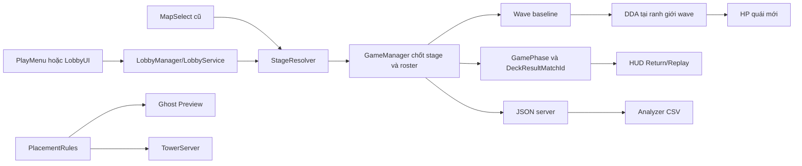
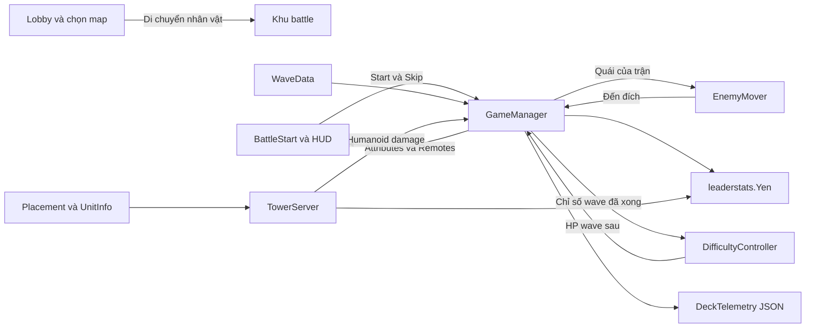
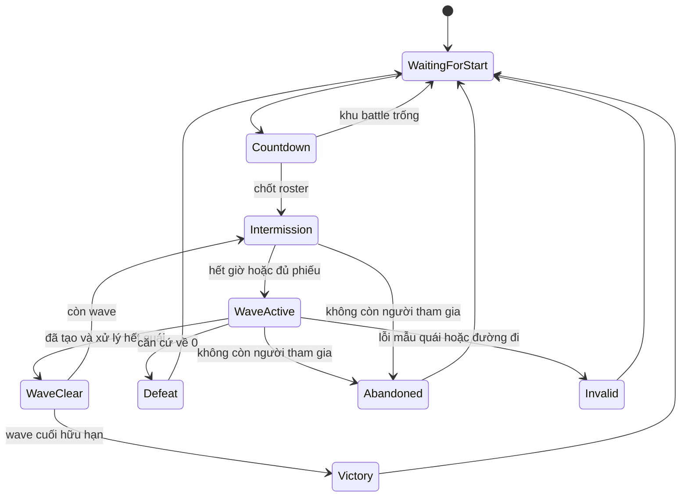

# Kiến trúc và vòng đời

## Cập nhật Phase 2

StageResolver tra StageData, lập cấu hình Act 3 hoặc dùng WaveData cũ. WaveConfig vẫn là module song song. Server lấy state của người yêu cầu và chỉ nhận các client cùng stage/difficulty vào trận. Return dùng TeleportToLobby. Replay được GameManager nhận trong phase terminal và xếp vào lượt kế tiếp sau thời gian hiển thị kết quả.

## Ghi nhận Phase 1

`GameManager` sở hữu roster, trận, wave, căn cứ, spawn và thưởng. `TowerServer` ghi giao dịch mua, nâng cấp, bán trên cùng IntValue và chỉ tìm mục tiêu trong Workspace.Enemies của trận. `EnemyMover` giữ tiến độ. `Damage → Humanoid.Died` và callback đến đích hội tụ về registry. Registry loại enemy trước khi hạch toán.

Server hiện có một trận dùng chung. Thành viên được chốt ở cuối countdown. Rời server hoặc khu battle trong trận kết thúc membership của người chơi đó. Các luồng chọn party và map đưa người chơi đến khu battle. `RequestStartMatch` là bước bắt đầu riêng. Các giá trị khó Easy/Normal/Hard từ menu cũ chưa quyết định WaveData. Startup scripts thay thế vắng trong RBXL kiểm tra, vì vậy đồng bộ chọn lọc theo hướng dẫn Studio.
